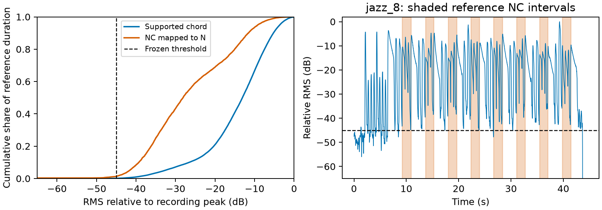

# Inspecting the no-chord labels

The 64 IDMT recordings contain 207 continuous `NC` runs across 32 recordings. They occupy 151.84 seconds between the first and last annotated beats. Many occur inside repeated rhythmic patterns. The dataset guide does not define their acoustic meaning; the evaluation maps `NC` to `N`.

The frozen recognizer assigns `N` only below −45 dB relative to each recording's peak RMS. Just 1.31% of reference `NC` duration meets this rule. The table describes energy measured with the recognizer's centred 2,048-sample RMS frames; each frame is weighted by its exact overlap with the reference interval.

| Reference | Duration | RMS 10th percentile | Median | 90th percentile |
| --- | ---: | ---: | ---: | ---: |
| NC mapped to N | 151.84 s | −39.29 dB | −28.09 dB | −11.57 dB |
| Supported chord | 1,180.55 s | −26.54 dB | −13.08 dB | −5.23 dB |

These distributions overlap. Energy alone does not tell us whether an NC interval contains decay, noise, or pitched notes. No new threshold was selected, and the saved recognition scores are unchanged.



The [listening view](jazz_8.html) shows `jazz_8`, selected because it has the greatest total NC duration (13.13 seconds). It embeds the original audio and frozen predictions, with controls to play each NC interval or include one second of context. This is an inspection aid; no listening judgements have yet been recorded.

[Interval measurements](intervals.csv), [full summary](summary.json), and [annotation review](../../docs/research/error_analysis/nc_annotation_review.md) preserve the measurements and source interpretation.

From the repository root:

```bash
.venv/bin/python -m chordrec.nc_diagnostic \
  --run results/optimization_v2/external \
  --data-root docs/datasets/IDMT-SMT-Guitar --output results/nc_repeat
```

Use a new output directory. This recomputes RMS and reads saved predictions; it does not run chord recognition.
